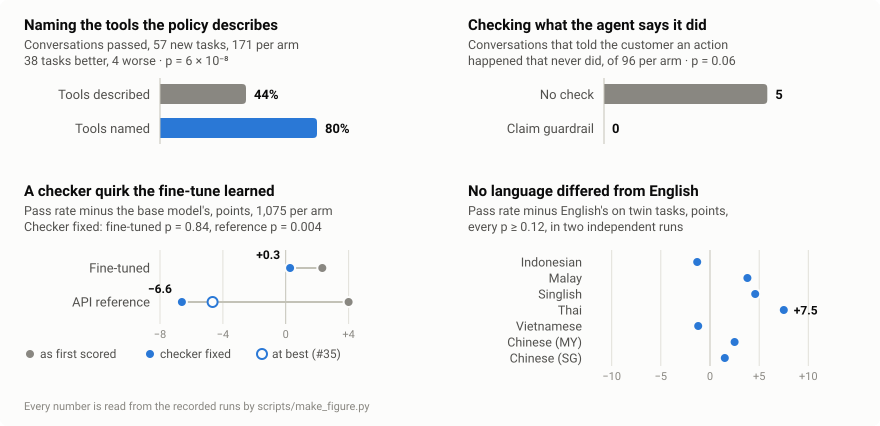

# PasarBench

A verifiable tool-agent **environment** for Southeast Asian e-commerce customer
service. 277 tasks — the 215 of the main suite (16 hand-written, 199 generated)
and a second edition of 62 for its five hardest traps — across 6 markets and 8
language varieties, 20 tools (303 with distractors), one policy document, and
verification on final database state rather than text. And a hard edition of 36
cases that combine the traps, read against their parts (v48): round 2's base
model passes 86% of them, against 92% of the newer tasks; on five API models
from four labs it is not harder than its parts (RUNBOOK 1s).

Because verification is programmatic, it is also a **reward function** — so the
same artefact measures agents and trains them.

```
rollouts ──▶ verifier ──▶ group advantage ──▶ policy update ──▶ rollouts
                                                                   │
                                       no human, no reward model in the loop
```

`pasar` = market (Malay/Indonesian). Hardware: a laptop for everything but serving and post-training, which run on one rented B200 (or H200, or two H100s: Modal Notebook, Modal jobs or Lambda, [docs/GPU_GUIDE.md](docs/GPU_GUIDE.md)).

**[Runbook →](docs/RUNBOOK.md)** · **[Results →](RESULTS.md)** · **[What failed →](docs/WHAT_FAILED.md)** ·
**[Writeup kit →](docs/WRITEUP.md)** · **[Blog post →](docs/BLOG.md)** · **[Build log →](docs/README_weekly.md)**

## What it found

Agent `deepseek-v4-pro`, simulated customer and judges `qwen3.8-flash`; for
post-training, agent `Qwen3.8-27B` against a `gemma-4-31B-it` customer. Every
number is regenerated from traces by `scripts/make_report.py`,
`scripts/audit_tool_arms.py`, `scripts/compare_cells.py` and
`scripts/language_swap.py`, and the figure by
`scripts/make_figure.py`, on today's checks — the runs' recorded verdicts are
re-scored by replaying their tool calls (`scripts/rescore.py`).

<picture>
  <source media="(max-width: 600px) and (prefers-color-scheme: dark)" srcset="docs/img/results-narrow-dark.svg">
  <source media="(max-width: 600px)" srcset="docs/img/results-narrow.svg">
  <source media="(prefers-color-scheme: dark)" srcset="docs/img/results-dark.svg">
  
</picture>

- **The fine-tune learned the verifier, not the policy.** RFT gained 2.3 points
  (p = 0.18) because two checks demanded one lookup tool where the policy only
  needs the fact. Corrected and re-scored — nothing re-run — the gain is 0.3
  points (p = 0.84), and the API reference the quirk had put 4 points above the
  base model is 6.6 below it (p = 0.004; on pass^k it was never ahead, and now
  trails by 9.7). A review found the first fix too loose; tightened, it moved no
  verdict ([WHAT_FAILED #30](docs/WHAT_FAILED.md)). Up to 1.9 of those 6.6
  points are the reference escalating under order "unknown", which the tool
  should have refused; refused and fixed, it would still trail by 4.7
  (p = 0.012; [#35](docs/WHAT_FAILED.md)).
- **A second fine-tune, its data balanced by trap, moved the leak instead of
  stopping it.** Round 2 ran everything again under today's customer and tools:
  base 0.962, fine-tune 0.954 (11 tasks better, 14 worse, p = 0.69), the null
  expected at that rate. The result fixed before the run was the failures: of
  the 24 episodes the fine-tune failed on tasks the base model always passed,
  nine were another trap's answer in the wrong place — round 1's peak-sale
  "wait" on customs holds again, and a new one, the photo trap's rule, now as
  present in the data as any other, applied to a MYR 186 serum read as "over
  SGD 200" ([WHAT_FAILED #44](docs/WHAT_FAILED.md)). The photo trap's own
  failures were the simulated customer's: told she had no photos, she sent them
  anyway in 64 of 210 conversations, and every one of those failed — a side
  effect of the rule that she wait for what she agreed to
  ([#43](docs/WHAT_FAILED.md)).
- **GRPO from those fine-tunes changed nothing measurable, and the trap that
  moved most was measuring the customer.** One iteration, read as fixed before
  it ran, on 62 newer tasks no model trained on: +0.026 against RFT, 7 tasks
  better and 4 worse, p = 0.55 — INCONCLUSIVE; on the held-out fold −0.004, 15
  better and 14 worse. Eight of the eleven tasks that moved were the voucher
  trap's. The agent offers "the voucher, or a human to review a full refund",
  and the simulated customer, who wants her money back, often asks for the
  human; P6.3 and P10 then ask for the escalation, and the check, which wants a
  voucher, fails it — 48 of the trap's 55 failures in round 2. Read as the
  policy reads them, GRPO's gain is +0.000, and the base model passes 96% of the
  newer tasks: above the 95% at which GRPO was to be held
  ([WHAT_FAILED #46](docs/WHAT_FAILED.md)). Nor did it show a gain on the
  tasks it trained on: measured there afterwards, 0.912 → 0.920, 16 tasks better
  and 13 worse, p = 0.71. On the held-out fold one answer turned up where it
  does not belong: mouldy dates escalated as a "safety issue", where the policy
  refunds a perishable without a return ([RUNBOOK phase 4, GRPO](docs/RUNBOOK.md)).
- **The hard edition has room, and it is hard where it was built to be.** On
  round 2's models under customer 3, the base model passes 0.861 of its 36
  combined cases; RFT 0.939 and GRPO 0.889, both INCONCLUSIVE against the model
  before them (p = 0.51, 0.45). All but one failure is one case: two orders in
  one chat, cushion covers "a different colour from the photos" delivered three
  weeks ago and a water bottle to cancel. The failing agents cancelled the
  bottle and asked for photos of the covers, as for a discrepancy on an item
  over SGD 200 — the covers are worth about SGD 58, and outside their window,
  where the policy gives a voucher; most told her the window was still open. One
  call, `check_return_eligibility`, answers both, and all but four of the 55
  failures had not made it. In Singapore, where the price is in SGD, no model
  failed the case; in Indonesia, at IDR 700,000, the base model failed it every
  time ([RUNBOOK phase 4, the hard edition](docs/RUNBOOK.md)).
- **On five API models the hard edition is not harder than its parts, and the
  parts separate them better.** DeepSeek-V4-Pro and V4.1-Flash, MiMo-V2.6-Flash,
  Grok 4.3 and GLM-5.3-Flash, under one customer: no agent's cases fail more
  than their parts (DeepSeek-V4-Pro's fail less, p = 0.039), and no two agents
  are separated by the cases where the parts do not — the parts separate
  DeepSeek-V4-Pro from three of the others, by the duplicate refund it fails 18
  times in 30 alone and 5 in 30 inside the livestream story. The two cases that
  held round 2's 27B models hold none of these but Grok. Reading the failures
  found two broken instruments: every generated profile's phone ends in other
  digits than the ones that verify her ([WHAT_FAILED #48](docs/WHAT_FAILED.md)),
  and the voucher choice's reader took a refused voucher for one she declined
  ([#49](docs/WHAT_FAILED.md)). The five agents cost about $6 in all
  ([RUNBOOK 1s](docs/RUNBOOK.md)).
- **Search-based tool exposure cost 22% more tokens and bought nothing**: 11.5
  points below exposing all 20 tools (7 tasks worse, 1 better, p = 0.07 — it
  read p = 0.021 before the checker fix). Of 21 times a failed episode needed a
  hidden tool, the agent never searched for it 17 times — always a tool the
  policy describes but never names. **Naming those three tools fixes it**:
  confirmed under a rule written before the run, on 57 tasks the first test
  hadn't used, pass^1 went from 0.44 to 0.80 (38 tasks better, 4 worse,
  p < 10⁻⁶) in every language, for 13% more tokens ([RUNBOOK 1g, 1h](docs/RUNBOOK.md)).
- **The agent claimed actions it never took** — only when the tool was out of
  sight: 3 of 14 readable search-arm failures, 0 of 19 elsewhere, and 12 of 42
  in the confirmation run's control; with the tools named, none (0 of 6, 0 of
  13). A runtime guardrail holds such a reply back and tells the agent which
  call would make it true. Its first version passed only by its own reading —
  the audit counted three false claims with it and three without
  ([WHAT_FAILED #34](docs/WHAT_FAILED.md)). The second, graded by the audit
  under a rule written before the run, took them from 5 of 15 readable failures
  to 0 of 13 against a same-day control; all four replies it held back were
  real, and each ended in the call and a passed case. Read by hand, softer
  wording still got through about as often with it as without — "your case has
  been flagged", a promise never kept ([RUNBOOK 1i](docs/RUNBOOK.md)). A model
  that reads claims in any language, calibrated on 626 recorded replies to take
  the phrase list's place, is not used: in English it held back every claim the
  list did and nothing more, but outside English it took the refund paid before
  the conversation for one the agent had made, four times in four languages —
  held back there, a reply sends the agent to pay it again
  ([RUNBOOK 1u](docs/RUNBOOK.md); its quote check failed too, on markdown,
  [WHAT_FAILED #50](docs/WHAT_FAILED.md)).
- **A second look after the customer left rescued what the agent let go — and
  refusing a repeat took away its cost.** When the customer ended the
  conversation, the agent got one note she never saw: check the case against the
  policy, make any call it requires. On the tasks that suggested it, pass^1 went
  from 0.85 to 0.96 (11 tasks better, 2 worse, p = 0.02) under a rule written
  before the run. On the other 158, replaying every episode as the customer left
  it and as it ended shows the note broke no case; the 10 tasks that did worse
  (6 did better, p = 0.45) had done so before it. By a second rule written in
  advance it is worth keeping as an option — 27 episodes rescued against 23 with
  a cost, most of them a case escalated twice, which no conversation did on its
  own (0 of 1,290). Read one by one it is about even, 22 against 23: five
  rescues were a customer who said "yes, go ahead" and left in the same message,
  before the agent could act; two "repeats" were a shipping credit the policy
  asks for; and two refunds after a cancellation paid back an authorization that
  was never charged ([RUNBOOK 1j, 1k](docs/RUNBOOK.md),
  [WHAT_FAILED #36](docs/WHAT_FAILED.md)). Confirmed on 62 new tasks of the
  traps that suggested it, with a customer who waits: 0.83 to 0.94, 15 tasks
  better and 5 worse (p = 0.04), 21 of its 25 rescues the escalation P10
  requires after a duplicate-refund customer is satisfied — and the same cost, a
  case escalated twice in 22 of 186 episodes, where the conversations alone did
  it in 2 of 372 ([RUNBOOK 1m](docs/RUNBOOK.md)). Giving the agent the record of
  its own calls, and telling it not to make one again, did not take that cost
  away (26 to 24 of 186, p = 0.66): nearly every second call, in every run, was
  its first answer to the note — 91 of 93 — made with the first call in front of
  it ([RUNBOOK 1n](docs/RUNBOOK.md)). Refusing it worked where asking did not:
  with 1j's note unchanged and a write that repeats one already made not run
  after it, 20 second tickets became none, the rescues stayed at 24, and nothing
  took the refused call's place ([RUNBOOK 1o](docs/RUNBOOK.md)).
  Where it was not built for, on the other 158 tasks, it broke no case and
  stopped the one repeat it met — but three times refused the shipping credit
  P4.6 asks for after a credit for the item: it compares a payment without its
  amount ([RUNBOOK 1p](docs/RUNBOOK.md),
  [WHAT_FAILED #39](docs/WHAT_FAILED.md)).
  With a payment's amount in what it compares (v41) it was safe there too: no
  case broken, the two refusals the same call again, and the shipping credit it
  had refused went through after the customer left — the guarded check can be on
  for the whole suite ([RUNBOOK 1q](docs/RUNBOOK.md)). The episode's token
  budget had cut 27 of its phases short; given room of its own, no phase was
  cut, and no rescue turned up that the budget had hidden.
- **The checks were blind where that second look walked.** Cancelling a card
  order, the agent told the customer her money would go back — 42 times in 42 in
  the last control, in every language — and nothing in the world did it: no
  rule, tool or check says what happens to it ([#37](docs/WHAT_FAILED.md)). And
  the simulated customer often said yes and goodbye in one message — "Sure, I'll
  take the voucher. Thanks." — ending the episode before the agent could act: 63
  failures in the runs without the closing check, 57 of them the voucher trap's,
  more than half of its failures. Counted as passes they reverse no result
  above; one, search against all 20 tools, would cross p < 0.05
  ([#38](docs/WHAT_FAILED.md)). Both are changed in v31 — a cancellation now
  settles the payment, and the simulated customer is told to wait for what she
  agreed to — with every recorded run re-scoring exactly as before. In the run
  that checked, she waited: none of 252 conversations ended on her yes, where
  the old customer ended 7 of the voucher trap's that way the same day, and the
  trap went from 0.81 to 1.00 ([RUNBOOK 1l](docs/RUNBOOK.md)).
- **An LLM judge could not stand in for the database.** Its best configuration —
  with the tool results and the policy — reached κ = 0.72 and still accepted 6
  of 15 failed episodes. It caught one of three false claims and noticed another
  but passed it; on its first run, given the same evidence, it had credited the
  one it caught. Calibrated on mistakes planted one at a time in transcripts the
  verifier passed, it caught every leak, invented total and rude line, but a
  missing identity check once in 20 — it read the agent asking for the digits as
  the check — and the 1–5 judge passed that copy 19 times in 20
  ([RUNBOOK, planted mistakes](docs/RUNBOOK.md)).
- **No language differed from English beyond noise overall**, in two independent
  runs. The only significant gaps in that comparison came from a fact-gating
  bug, and the simulator "leaks" behind it were the detector's
  ([WHAT_FAILED #26](docs/WHAT_FAILED.md)). One rule does differ, and the
  suite-wide number hides it: P10's escalation of a refund already paid, "even
  if … the customer accepts it". Read back over every recorded run,
  deepseek-v4-pro made it in 59% of English conversations and in 2–8% of Malay
  and Chinese ones, and all 14 local-language tasks made it less often than
  their English twin — 38 points on average, p = 0.0001 — in the runs recorded
  before anyone looked as on new tasks. It decides when it reads the refund; on
  the policy's three other escalations the languages are level, and Qwen3.8-27B
  shows no gap ([RUNBOOK 1j, 1r](docs/RUNBOOK.md)).
- **And the language itself moves that decision.** Held fixed where the agent
  reads the refund — her turns and its replies translated, the refund, tools and
  world unchanged — the same conversation got the escalation more often in
  English: 47 conversations more often, 16 less (p = 0.0001), and the same way
  in both directions, under a rule written before the run. Moved into English, a
  conversation's escalations went from 16% of runs to 35%; moved out of it, from
  50% to 31%; translated there and back, no significant change. By language,
  read and not tested, it is Malay, Chinese and Vietnamese, with Thai and
  Indonesian level; and it is a little over half of the gap between these
  recordings — the rest stays with the conversation, her words and the agent's
  earlier replies ([RUNBOOK 1t](docs/RUNBOOK.md)). Whether other agents show it
  could not be tested: DeepSeek-V4.1-Flash and MiMo make the escalation in over
  90% of runs in every language, and GLM's decision there changes from one run
  to the next ([RUNBOOK 1w](docs/RUNBOOK.md)).
- **Put the policy in her language too, and on average the gap closes.** The
  same 96 conversations, held in her language, got the escalation in 22% of runs
  under the English policy and 44% under the policy translated into hers — 47
  conversations more often, 14 less (p < 0.0001), in both directions — against
  45% with conversation and policy both in English. It closes where the prompt
  names the tool the rule calls, which is where the gap was, and not in Malay or
  Malaysian Chinese, which stay far short of English under their own policy
  ([RUNBOOK 1v](docs/RUNBOOK.md)). Read after the run, the prompts that did not
  name the tool were mostly from runs that showed the agent every tool, where her
  policy did not help; the rest hid the tools behind search, where nothing was
  escalated in any language. Whether a name is what makes a translated rule work
  with every tool in sight is RUNBOOK 1x, its reading fixed and not yet run. And
  Malaysia's floor may not be its languages: in the runs that showed every tool,
  the same English words got the escalation for 8 of 8 Indonesian orders and 0 of
  8 Malaysian ones ([RUNBOOK 1v, 1x](docs/RUNBOOK.md)).

---

## Status

| milestone | state |
|---|---|
| Environment: 277 tasks, 16 traps, 6 markets, 8 languages, checks on database state | done |
| Harness: context strategies, tool exposure, simulated customer, replay, claim guardrail, closing check and its guard | done |
| API experiments, RUNBOOK 1a–1w: 43 runs of API agents, 15,050 episodes in `traces/`; 2,691 continuations of recorded conversations (1t, 1v, 1w) | done |
| The recorded traces as a Hugging Face dataset (`scripts/export_hf.py`) | published on the Hub (v44, 34 runs); v70 packs the language swap beside the episodes — every continuation, and every message each arm showed the agent, rebuilt and checked — 57 runs and 2,691 continuations, 282 MB, to upload |
| Judge calibration | labels nearly all "satisfied" (WHAT_FAILED #24); planted mistakes run: 4 of 9 criteria can be left to the judge, identity verification caught 1 in 20 |
| Post-training round 1: RFT on Qwen3.8-27B | done: no gain once the checker was fixed |
| Post-training round 2: a fine-tune balanced by trap; GRPO | round 2 done: no aggregate change, the leak moved (WHAT_FAILED #44); GRPO, one iteration: INCONCLUSIVE on the 62 newer tasks (+0.026, p = 0.55) and on the held-out fold, and +0.000 once the voucher trap's escalations after a declined voucher are read as the policy reads them (#46); on its own 61 training tasks, measured afterwards: NOT SHOWN (0.912 → 0.920, p = 0.71) |
| The language swap: a recorded conversation held fixed where the agent reads the refund, only its language changed (RUNBOOK 1t) | run (2026-10-13): LANGUAGE — English higher, +0.191, 47 conversations against 16, p = 0.0001, the same sign each way; the translator alone INCONCLUSIVE |
| A model that reads the claims in any language, in place of the English list (RUNBOOK 1u) | calibrated (2026-10-13) on 626 recorded replies: not used — it took the refund paid before for a payment, 4 times, all outside English; the list stays and the live run is not run. Its quote check counted markdown as invention (WHAT_FAILED #50, fixed in v61) |
| A policy in her language: the same 96 conversations, the policy translated into the conversation's language (RUNBOOK 1v) | run (2026-10-14): POLICY — her language's escalations went from 22% to 44% under the translated policy, 47 conversations against 14, p < 0.0001, both directions; level with English (45%) on average, so the gap closes as far as this run sees — where the prompt names the tool, and not in Malay or Malaysian Chinese. The translation was stopped twice before it ran: a section in Malay that every check passed, then every prohibition set in bold ([WHAT_FAILED #51](docs/WHAT_FAILED.md)) |
| The tools named in the policy, crossed with its language, where every tool is shown (RUNBOOK 1x) | built (v70), not run: 88 conversations, 1v's three arms each with the tools named and not, 1,584 continuations (~$2 off-peak); the reading fixed before the run |
| The swap on three other agents, each from its own recorded conversations (RUNBOOK 1w) | run (2026-10-13): not seen beyond DeepSeek-V4-Pro, and not testable here — DeepSeek-V4.1-Flash and MiMo escalate in over 90% of runs in every language (NO ROOM), GLM's decision splits from run to run (its reproduction 23 of 35: not read); Grok left out before the run |
| A hard edition of combined cases; a multi-model baseline | hard edition built (v48): 36 cases outside the suite, `--suite edition3`, their reading fixed (RUNBOOK 1s; on round 2's models, phase 4); its customer, customer 3, checked (WHAT_FAILED #43); on round 2's models: room (base 0.861), RFT and GRPO INCONCLUSIVE, hard in one case; on five API models (2026-10-13): not harder than its parts for any, and it separates no two the parts do not (RESULTS §8) — one command adds a model (`scripts/add_model.py`, v55; `--check` for which keys and models work, v56) |
| Serving cost: the agent served three ways — the policy in the prompt with SGLang's radix cache on and off, and looked up instead (RUNBOOK phase 3) | built (v68): one GPU stage, ~1 h of a B200, each bar's quality verdict before any speed or cost claim, the cache's hits split into a conversation's first request (shared — flattered by this suite's six customers) and its later ones; not yet run |

---

## Quickstart

```bash
./run_tests.sh                    # every suite, from any directory
```

Or individually, **from the repo root** (the one containing `README.md`, not the
`pasarbench/` package inside it — that nesting is the most common first-run
mistake):

```bash
python -m pasarbench.run          # null agent → 0.0, reference agent → 1.0
python -m tests.test_traps        # 10 naive solutions, all must be rejected
python -m tests.test_harness      # 184 harness invariants, the claim guardrail and the model that can read for it in any language -- made one way, one cache, its quotes found without the reply's markdown, an answer cached under the old check read again without a call, and the check in a run's header, which --resume compares (WHAT_FAILED #50), what it could not read on the step, and an episode ended as a server error when it cannot be reached (v50), the closing check -- 1j's note, the case record (RUNBOOK 1n) and the guard that does not run a repeat (1o), a phase with room of its own when asked (v49), which no reference solution trips and which since v41 reads a payment's amount (WHAT_FAILED #39) -- and every context strategy keeping either note, tools that refuse what their schemas don't allow and a cancellation that settles the payment once while old runs replay under the tools they ran with, a simulated customer told to wait for what she agreed to, and customer 3, who leaves after a promise she cannot keep and never sends photos she lacks (WHAT_FAILED #43), and every key sent to its own provider and no other, under any of the names it goes by (WHAT_FAILED #47), with one routing id a conversation to xAI, whose cache is per server, and to Z.ai messages as its schema documents them
python -m tests.test_reward       # 30 reward + dataset invariants
python -m tests.test_generated    # 196 checks over all 199 generated tasks, the 62 of the second edition (RUNBOOK 1m) and the hard edition's 36 (1s): dates in causal order, the same world in every process, reads of the task's own order, simulator QA -- the photos a customer told she has none says she sent, in eight languages (WHAT_FAILED #43) -- each hard case's wrong turns failing in every market, her change of mind read in eight languages and in the Malay round 2's customer wrote, each case against its part -- and read again as the policy reads a declined voucher (WHAT_FAILED #46) -- and the suite and the second edition pinned byte for byte
python -m tests.test_rescore      # 29 re-scoring invariants: the pre-v19 world, replay by digest and by length, the same tool errors on every Python, nothing re-scored on a guess
python -m tests.test_context      # 39 context-strategy + analysis invariants
python -m tests.test_judge        # 102 judge + agreement-statistics invariants, judged against today's checks, and the planted-mistake calibration
python -m tests.test_exposure     # 287 tool-scaling + diagnosis invariants, the tool-naming experiment and its confirmation tasks, the guardrail's report and dry run, the closing check's report, its costs, two closing notes compared by task and the record each episode was given, the closing guard's refusals and its dry run, one run's closing phase read on its own, each case before and after it and what each customer last said, a write a database check needs told from one no check sees, readers that skip its case note, how episodes ended and what cancellations settled, listed, cells compared across tool versions, customers, closing room or claim reader flagged, episodes a server error ended, the duplicate-refund trap by language, twin against twin, a recorded conversation held fixed where the agent reads the refund and only its language changed (RUNBOOK 1t) -- and only its policy's (1v), every piece of the translated policy checked for its language, codes, numbers, rules and emphasis before a run starts -- a word stressed in capitals may be bold where the script has none, a prefix whose policy cannot be changed stopped before any spend, and search_policy answering in it, its gap read by direction and by whether the prompt names the tools, or any agent's own (1w), each test's verdict the way its sign test points, at the p its reading names, and an agent with no room said to have none -- the claim reader calibrated on recorded replies, under the quote check it names, with the list's alarms beside its own outside English and a reading made under the old check kept, and a live run read as it was read (1u), a customer's claimed photos counted in both cells, and the voucher she declined for a human, with the paired line read as P6.3 and P10 read it (WHAT_FAILED #46) and a refused voucher never read as one she declined (#49), every failure on a task the control always passed set out to be read, another lab's model added with one command, its key typed and sent to its own endpoint only, which keys and models work checked before it with no key written down, a missing key asked for and saved to .env under the name the runs read, .env read by name only, each run's own record of why it stopped, and the traces packed as a dataset with nothing in them that must stay on this machine, and 1t, 1v and 1w read into RESULTS' section 9 -- and 1x: 1v's arms with the tools named and not, an arm and its twin differing in the marks alone, conversations whose run showed every tool, its test over them and each comparison read with it, and the swap's runs packed beside the episodes, every arm's messages rebuilt from the cache with no call and checked against the digest each continuation records, one that cannot be stopping the export
python -m tests.test_serving      # 70 metrics (SGLang and vLLM), cost and quality-guard invariants, and phase 3's bars: each measured whole, its server's cache as the bar needs, its report from the counters' diffs and the traces at the price the stage ran at, and RESULTS' section 5 read from them or marked not measured
python -m tests.test_report       # 96 report invariants: paired verdicts, ties, replication, calibration and its planted mistakes (before they are read, only the steps not yet taken), noise floor, post-training with one customer and one tool version, round 2 first and round 1 as context, GRPO read as fixed before it ran and the voucher trap's escalations read as the policy reads them beside it, its learning curve's measured point, the hard edition on round 2's models read as fixed before it ran, the hard edition against its parts on several labs' models and which pairs only the cases separate (section 8), both scorings in every section, a figure that matches its numbers and drops a title they stop bearing out
python -m tests.test_training     # 264 checks: split, customer family, collection and resume, examples (Qwen3 and Qwen3.8 formats) against an SGLang-like server, adapter routing, the LoRA probe, serve and Modal scripts, the serving stage's three bars, one-GPU memory plans, the notebook helper (progress in place, an interrupt-proof cleanup, a pack of only what is new since the last), the CUDA compiler, run settings, LoRA steps on Qwen3 and Qwen3.8's hybrid architecture, training data picked by today's checks, a push script that keeps runs and keys off GitHub, closing-check runs refused as training data, one simulated customer in every step, kept from stage 1 to stage 2, server errors reported, round 2's training data balanced by trap and its runs named apart from round 1's, GRPO's build, update and stage, its tasks without the photo trap, its reward's reading of the voucher she declined (WHAT_FAILED #46) and its learning curve measured on its own tasks (grpo-measure), the customer check, the hard edition's stage (195 without transformers/torch)

python -m pasarbench.sweep --backend scripted --suite all
python scripts/make_report.py     # regenerates RESULTS.md; never hand-fill it
python scripts/rescore.py         # what today's checks change in every recorded run
python scripts/make_figure.py --traces traces   # redraws the figure above from the runs
```

The benchmark, harness, reward and judge layers have **zero dependencies**
(Python 3.10+). Model backends use `urllib`. Everything in `requirements.txt` is
for the training track only.

---

## What makes it different from a weekend benchmark

**Verification is on final database state, not text.** The agent's prose is
never scored for correctness. A task passes when the right rows exist with the
right values, the required calls happened, no forbidden call happened, and
ordering constraints hold. Text-similarity scoring is what makes most homemade
agent benchmarks meaningless.

**Tools enforce data integrity, not policy judgment.** `issue_refund` blocks a
COD refund because there is genuinely no instrument to refund to. But
`initiate_return` will happily open a return 19 days after delivery — that is a
*policy* error and catching it is the agent's job. If the tools enforced
everything, every agent would score 100% and the benchmark would measure
nothing. This is the line most homemade benchmarks get wrong in the safe
direction.

**Every generated task ships with a generated reference solution.** At 16 tasks
you can check a suite by reading it. At 199 you cannot, so the guarantee is
mechanical: the suite asserts every task is solved by its own solution, fails
under the null agent, and fails under a tool-spam adversary.

**Locale twins share a byte-identical checks object** — asserted with `is`, not
equality. A Thai task and its English twin have the same world and the same pass
criteria; only the words differ. That is what licenses attributing a score gap
to language at all.

---

## The suite

| axis | decides | values |
|---|---|---|
| **trap** | the checks — what correct behaviour is | 16 |
| **market** | the world — currency, payment rails, order data | SG MY ID TH PH VN |
| **language** | the surface form — what the customer types | en, sg-en, zh-SG, ms, zh-MY, id, th, vi |

Chinese is included because Singapore is majority ethnic Chinese and Malaysia
has a large Chinese-speaking population — a SEA e-commerce benchmark that omits
it is not modelling those two markets. Both use **simplified** characters
officially; traditional belongs to Taiwan, Hong Kong and Macau, which are not
markets here, so a "traditional" variant would be inauthentic rather than more
thorough. Written Cantonese is likewise a Hong Kong register: a
Cantonese-speaking shopper in KL types standard written Chinese to support, so
Mandarin-register simplified is the faithful choice for a text benchmark.

SEA-specific content that no US-built benchmark has: **cash on delivery** (no
instrument to refund to), **livestream purchase disputes**, **zero-minor-unit
currencies** (IDR and VND — an agent that divides by 100 is wrong in two of the
six markets), peak-sale SLA extensions, and customs holds.

### The flagship trap

`livestream_claim_overrides_window`: delivered 15 days ago, so every surface
signal says out-of-window → offer a voucher. But P7.2 waives the window when a
seller's livestream claim went unfulfilled — an exception in a later section
overriding an earlier rule. The agent must notice the purchase came from a live,
call `get_livestream_claims`, and understand policy precedence. Models that
pattern-match on "14 days" fail it, and the trace shows exactly why.

---

## The harness

No framework. `harness/loop.py` is ~200 lines of control flow and every branch
exists because something breaks without it.

```
harness/types.py       messages, tool calls, budgets, episode state
harness/backends.py    scripted/mute/confused/failing + OpenAI-compat + Anthropic
harness/context.py     5 pluggable context strategies — the ablation seam
harness/exposure.py    tool-exposure arms + 300 distractors + progressive disclosure
harness/simulator.py   scripted + persona-driven user simulators
harness/prompts.py     preload vs JIT policy modes
harness/guardrail.py   holds back a reply that claims an action no call made
harness/closing.py     one hidden look at the policy after the customer leaves
harness/trace.py       JSONL traces, one file per episode
harness/replay.py      rebuilds what a recorded episode saw, by replaying its calls
harness/loop.py        the loop
```

Validated by running the reference solutions **through** the loop rather than
around it: `scripted_harness_agent(SOLUTIONS)` scores 1.0, `MuteBackend` scores
0.0.

Four decisions worth defending:

- **An unanswered tool call corrupts the conversation.** When the tool-call
  budget runs out mid-batch the loop still emits an error result for each
  remaining call. Skipping them is the obvious implementation and produces a 400
  on the next request.
- **Context units are atomic.** An assistant message with tool calls plus the
  tool messages answering it is one unit truncation must never split. Most
  homegrown sliding windows have this bug; it surfaces as an error rate people
  blame on the model.
- **Backend exceptions end one episode, not the sweep.**
- **Malformed tool arguments are data, not exceptions** — returned to the model
  as a recoverable error. Small models emit broken JSON constantly, and
  disproportionately on non-Latin scripts, which is exactly the signal the
  multilingual diagnosis is looking for. Since v27 so are well-formed arguments
  the schema does not allow — a category it does not list, an order that does
  not exist — which the tools once took silently ([WHAT_FAILED #35](docs/WHAT_FAILED.md)).

Interrupt and resume are real: `snapshot()` serialises episode state plus the
database, `restore()` continues, and the test asserts an identical final DB.

---

## Experiments

### Context ablation — 5 strategies × 2 policy modes

`full`, `window8`/`window4`, `trim3` (shrink old tool payloads to their
ok/error verdict), `summarize4` (running **structured** summary), `notes4`
(agent-written scratchpad).

**JIT is not a context strategy.** `policy_mode` governs the system prompt;
context strategies govern conversation history. They are orthogonal — folding
them into one axis is why many published context ablations cannot be read.

Two decisions decide whether `summarize` works: **structured, not free-text**
(a generic summary prompt drops exactly what the policy gates on — whether
identity was verified, and what eligibility returned), and **running, not
redone** (only new units are folded in, so cost is O(n) not O(n²)).

`notes4` has a failure mode that hides itself: if the agent never writes notes,
it degrades to a naked sliding window and the pass rate still looks like a
measurement. `note_discipline` is reported every sweep for that reason.

### Tool scaling — the confound that ruins two-arm studies

Token cost and selection difficulty degrade together, so 20-vs-300 is
unreadable. Four arms separate them, and **`random-N`** does the work: N tools
at random but always containing the ones the task needs — same token cost as
`all-N`, same reachability as `oracle`. The sweep warns you if you run without
the pair.

Measured on the reference path: `oracle` injects 431 schema tokens per call,
`all-100` injects 9,670, `search-300` injects 445 while reaching 300 tools.

### Multilingual diagnosis — mechanisms, in the order you must rule them out

1. **Budget exhaustion** — if non-English hits the ceiling more often, the gap
   is a *harness artefact* and every conclusion drawn before raising the budget
   is wrong. Checked first, above every model explanation.
2. **Tokenisation inflation** — tokens per character vs English.
3. **Retrieval miss** — `search_policy` and `search_tools` are keyword matchers
   over English text. `_rank_tools("refund money to the customer")` returns
   `issue_refund`; `คืนเงินให้ลูกค้า` returns **nothing**. That is a property of
   the system, not a bug to hide.
4. **Malformed tool arguments** — the harness's distinct recoverable error.
5. **Language drift** — the agent replies in English to a Thai customer. Passes
   every state check; caught only by the judge.

`attribute_gap` carries its own caveat into the output: these are
**co-movements, not causal attributions.**

### Judge calibration

Nine binary criteria targeting what state verification structurally cannot see —
data leakage, hallucinated facts, policy accuracy (all critical), plus
`language_match`, which is why a model can pass every state check while replying
to a Thai customer in English.

Kappa is reported with **prevalence and PABAK**, because on a criterion
satisfied 95% of the time two labellers can agree 96% and still score κ = 0.32.
And with a bootstrap CI, because a move from 0.62 to 0.68 with overlapping
intervals is not an improvement.

**The ceiling:** a judge cannot agree with you more than you agree with
yourself. Round 2 re-labels a subset blind, and agreement is reported as a
fraction of that test-retest κ.

**Planted mistakes** (v45): the 200 labels hold two violations in 1,800
answers, so the calibration makes its own. Transcripts the verifier passed,
each beside a copy with one mistake planted — another customer's order read
out, a total no tool gave, a 30-day return window, a refund with the identity
check taken out — measure per criterion how often the judge catches it and how
often it flags the clean originals (`scripts/judge_calibration.py`). Run once,
against a bar fixed before it: four of nine criteria can be left to the judge —
leaks, invented facts, unexplained escalations, tone — and five score nothing.
The worst is identity verification, caught once in 20: with the check taken out,
the judge credited it anyway, quoting the agent's request for the digits
([RUNBOOK, planted mistakes](docs/RUNBOOK.md)).

### Serving and cost

**The metric is cost per *resolved* conversation.** Escalations consume human
agent time and failures come back as second contacts, so at any realistic wage a
few points of escalation rate outweigh the entire model bill — which lands at a
low single-digit percentage of total cost in both arms of the worked example.
A model 6× cheaper to run can be 3.8× more expensive per resolution.

**No speed win is declared without a proven quality result.** `serving_verdict`
returns WIN only on non-inferiority at a stated margin. The third verdict is the
honest one: at 215 tasks a 2-point regression is undetectable (`required_n` says
~6,000 per arm), so INCONCLUSIVE is frequently correct. One GPU stage measures
the agent served three ways — the policy in the prompt with the radix cache on
and off, and looked up instead — under a reading fixed before it runs; in this
suite most conversations share one of six customers, so the cache's hits on a
conversation's first request are reported apart from the rest
([RUNBOOK phase 3](docs/RUNBOOK.md)).

### Post-training

The verifier is a **verifiable reward** — no human, no reward model. The reward
is designed not to be hacked and it is tested: partial credit is clipped below
the pass floor (`min(passing) > max(failing)` asserted over the whole suite), a
forbidden action *gates* credit to zero rather than subtracting, and excess
steps cost. The tool-spam policy is in the test suite as an adversary.

Order of work: **RFT first** — on a verifiable environment it recovers most of
the gain with no RL infrastructure, and it is the only meaningful GRPO baseline.
A GRPO number reported against the base model conflates "RL worked" with
"training on correct trajectories worked."

**What it did:** nothing measurable, once two checks that preferred a lookup
tool were corrected — on those traps the fine-tune had learned the preference
([WHAT_FAILED #30](docs/WHAT_FAILED.md)) — and it moved behaviour between traps
([#31](docs/WHAT_FAILED.md)). RESULTS.md §6 has both scorings. `train_rft.py
build` now picks training episodes by today's checks, not the verdicts the
collection recorded. Round 2 balanced the training data by trap, as #31 said to:
no aggregate change again, and the leak moved to the trap the balance had added
([#44](docs/WHAT_FAILED.md)). GRPO from those fine-tunes, one iteration:
INCONCLUSIVE on the newer tasks it was judged on, and +0.000 there once the
voucher trap's escalations after a declined voucher are read as the policy
reads them ([#46](docs/WHAT_FAILED.md)); on the tasks it trained on, measured
afterwards, no gain shown either.

The design, sized for one rented B200 (`docs/RUNBOOK.md`, phase 4; every step
of running it, for a first-time GPU user, in `docs/GPU_GUIDE.md`):

- **Qwen3.8-27B, LoRA in bf16.** No quantized base, so the model trained is the
  model evaluated; logits only at the trained turn, because a 248k vocabulary
  makes full logits the largest tensor in the step. 32 turns per optimizer
  step whether one card accumulates them or several share them.

- **Two folds by family.** Locale twins stay together and every trap is in
  both folds; each fine-tune is scored only on the fold it did not train on, so
  all 215 tasks are held out once, paired by task against the base model.
- **One example per agent turn**, with loss on that turn only and the prompt's
  token ids taken from the serving SGLang's `/tokenize` — the server renders
  the tool list from its own dump of it, so a local render of the same
  template is not what the model saw. A whole-conversation render is wrong for
  Qwen3 (`pasarbench/rl/sft.py`).
- **A customer from another model family** (Gemma 4 31B for a Qwen agent),
  enforced by the sweep, with the API reference re-run against the same
  customer. Serving is SGLang: agent (bf16) and customer (FP8) on one card,
  each server's memory worked out from what is free when it starts
  (`scripts/gpu_plan.py`), or one card each on a two-GPU machine.
- **GRPO from the RFT adapter** (v45), on the same tasks it was trained on:
  rollouts at temperature 1 on the ones the model sometimes fails, a group used
  only when its verdicts differ, every turn of a rollout carrying its
  advantage, a clipped policy gradient on the LoRA. Judged on the 62 newer
  tasks no model trained on, because the held-out fold has no room at 0.98.

---

## Repo map

```
pasarbench/
  db.py tools.py policy.md tasks.py verifier.py   the environment
  generate.py locales.py                          199 generated tasks, 3 orthogonal axes
  harness/                                        the runtime, the claim guardrail, the closing check
  rl/                                             reward, folds, per-turn RFT and GRPO examples
  judge/                                          rubric, judges, agreement stats, planted mistakes
  analyze.py diagnose.py simqa.py                 turning sweeps into findings
  rescore.py                                      recorded episodes, today's checks
  serving/                                        metrics, cost, quality guards
  sweep.py run.py                                 entry points
scripts/    gpu_pipeline.sh gpu_plan.py modal_pipeline.py pasar_notebook.py
            cuda_home.py setup_node.sh download_weights.sh
            serve_sglang.sh train_rft.py train_grpo.py make_report.py
            audit_tool_arms.py inspect_trace.py run_judges.py rescore.py
            compare_cells.py naming_tasks.py guardrail_dry_run.py make_figure.py
            slurm_train.sh slurm_sweep.sh modal_vllm.py closing_guard_dry_run.py
            closing_report.py language_lead.py export_hf.py judge_calibration.py
            read_failures.py serving_bars.py
tests/      12 suites, 1,000+ assertions
docs/       RUNBOOK.md  GPU_GUIDE.md  WHAT_FAILED.md  WRITEUP.md  BLOG.md  README_weekly.md
            img/  the results figure, light and dark, wide and narrow, and its numbers
```

---

## Limitations

Stated plainly, because a limitations section nobody wrote is the first thing a
careful reader notices.

- **215 tasks cannot detect a 2-point regression.** ~6,000 per arm would be
  needed. The tool arms are 32 tasks each. Several verdicts in this work are
  honestly INCONCLUSIVE.
- **Few models.** The ablations are one agent (`deepseek-v4-pro`) judged by
  one judge (`qwen3.8-flash`); post-training is one base model (`Qwen3.8-27B`),
  one recipe, one run. Another lab's model on the hard edition is one command,
  `python scripts/add_model.py`, its key typed and sent to its own provider
  only (RUNBOOK 1s; [WHAT_FAILED #47](docs/WHAT_FAILED.md)); `--check` says
  first which keys and models work, and RUNBOOK 1s what a model's run costs.
- **A check encodes a choice about what establishes a fact.** v19 found two
  that demanded one lookup tool, and one that demanded identity verification
  where the policy asks for it only before a write
  ([WHAT_FAILED #30](docs/WHAT_FAILED.md)). Others may still be waiting: what a
  trap's failures have in common is where to look.
- **The false-claim check reads English only**, and only the phrasings it was
  written for — the same kind of instrument as the leak detector, so its counts
  are a floor. A model that reads any language in its place, the check against
  the tool log kept mechanical, was calibrated on 626 recorded replies and is not
  used (RUNBOOK 1u): in English it held back what the list did, and outside it
  took the refund paid before the conversation for one the agent made.
- **Thai and Vietnamese translations are drafted, not native-reviewed.** English,
  Singlish, Malay, Indonesian and both Chinese varieties were written directly;
  Singlish deliberately was not machine-translated, because the particles and
  code-switching are the part that breaks agents.
- **52 of 199 generated tasks are "do no harm" traps** that a cautious
  lookup-only agent passes for free — and so does one that stalls: 4 of the 234
  photo-trap episodes the v19 checks promoted never asked for photos.
  `tests/test_generated.py` exempts them explicitly rather than pretending
  otherwise. They are the argument for the judge.
- **Prose-only policy rules are unverifiable by state checks.** P1.4 (never
  disclose another customer's data) cannot be checked by looking at the
  database; those tasks were left out rather than checked badly.
- **The hard edition is hard for small fine-tuned models, not for API models.**
  Its 36 cases pass their reference solutions and fail the wrong turns each was
  built for, in every market; on round 2's Qwen models they leave room, and on
  five API models they are not harder than their parts (RUNBOOK 1s). An edition
  that separates API models needs combinations that defeat them. Its worlds, like
  every generated task's, give the customer's profile a phone that does not end
  in her verifying digits (WHAT_FAILED #48), left as every run had them until the
  next edition. One case — the customer who changes her request with her phone
  digits — is only fair where the simulated customer says it there, which
  `inspect_trace.py` reads (section 4b); she did, on round 2's models and on
  these.
- **GRPO ran one iteration, and its test set had less room than it seemed.**
  The rollouts, advantages and update (`scripts/train_grpo.py`,
  `pasarbench/rl/grpo.py`, the `grpo` stage) were tested end to end on toy
  models only before it ran; the old log-probabilities are the trainer's own,
  not the sampling server's, and there is no KL term. It trains on no
  photo-trap task, whose verdicts in round 2 were the customer's
  ([WHAT_FAILED #43](docs/WHAT_FAILED.md)), but on the voucher trap's, whose
  verdicts were partly hers too: where she declined the voucher for a human,
  a rollout the policy calls right scored as a failure
  ([#46](docs/WHAT_FAILED.md)). Its learning curve has two points, and the
  second shows no gain even on the tasks it trained on: one update of this size
  moved nothing measurable.
- **The simulated customer's rules are shared by every trap.** The rule that
  she wait for what she agreed to (v31) fixed the voucher trap and made the
  photo trap's customer send photos she was told she had none of. The stage-1
  audit now counts that, and comparisons print it. Customer 3, who leaves
  after a promise she cannot keep and never sends photos she lacks, is opt-in
  (`--customer 3`) and checked: no claim of photos reached the agent in 70
  photo-trap conversations, where customer 2's did in 31, and the duplicate
  refund held. The hard edition runs with her; round 2's photo-trap numbers are
  customer 2's.
- **The policy offers one thing the tools refuse.** P8.3 tells the agent to
  offer a customs-held customer the choice to cancel; P2.2 and `cancel_order`
  refuse a shipped order. No check reads the attempt, so no verdict moves, but
  an agent that follows P8.3 offers what it cannot do
  ([WHAT_FAILED #45](docs/WHAT_FAILED.md)). The hard edition leaves customs out:
  settling it changes the policy text every edition's agent reads, so it waits
  for a policy version of its own.
- **The leak audit is only as good as its ask-patterns.** They cover the
  phrasings `deepseek-v4-pro` used across four runs and `Qwen3.8-27B` across
  three, where no reveal outside English was unprompted
  ([WHAT_FAILED #26](docs/WHAT_FAILED.md)). Another agent can ask in words the
  list lacks, and the customer's answers will read as leaks: read the line
  `inspect_trace.py` prints under each one first.
- **Default cost rates are illustrative placeholders.** GPU hourly rates vary by
  3× across providers.
